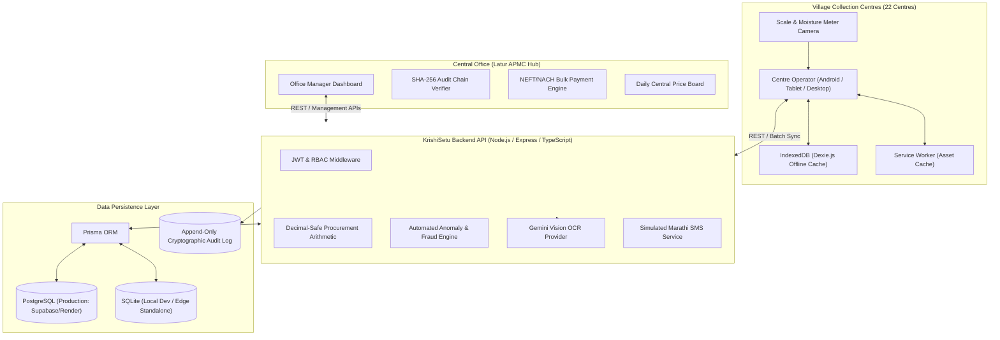

# KrishiSetu — Architecture & Technical Specifications

**KrishiSetu** is an enterprise-grade agricultural procurement and direct farmer payment management platform designed specifically for Farmer Producer Companies (FPCs), with its primary reference implementation for the 6,200 member farmers across 140 villages and 22 village collection centres in Latur, Maharashtra.

---

## 1. High-Level System Architecture

---

## 2. Offline-First Architecture & Data Synchronization

In rural mandis, mobile connectivity is frequently intermittent. The collection workflow cannot pause when network drops.

### Local Persistence & Offline Queue
- **IndexedDB via Dexie.js**: All master records (registered farmers, published daily price board) are mirrored locally in IndexedDB tables (`cachedFarmers`, `cachedPrices`).
- **Unfinished Drafts**: Operator entry form auto-persists to `localDrafts` to prevent data loss upon device reboot.
- **Offline Purchase Queue**: When offline (`navigator.onLine === false`), purchases are immediately enqueued into Dexie `offlineQueue`. A unique client UUID (`idempotencyKey`) and client timestamps (`clientDeviceTimestamp`, `localCreationTimestamp`) are assigned.
- **Immediate Farmer Slip Generation**: Even without internet, a local valid procurement slip (`C07-OFFLINE-XXXX`) is issued to the farmer immediately.
- **Automatic & Manual Resumption**: When connectivity returns, `SyncContext` detects the online event and auto-triggers `SyncManager.processSyncQueue()`. A prominent manual sync button allows operators to force synchronization at any time.

### Idempotency & Tamper Prevention
1. **Duplicate Prevention**: Every sync payload carries an `idempotencyKey`. The server checks the key against both `SyncRecord` and `Purchase` tables. Duplicate submissions are recognized and acknowledged without creating multiple purchase records or financial liabilities.
2. **Server-Side Recalculation**: The server never trusts client-computed amounts or weights. It re-evaluates all procurement formulas independently:
   $$\text{Actual Weight} = \text{Gross Weight} - \text{Tare Weight}$$
   $$\text{Moisture Deduction \%} = \max(0, \text{Moisture} - 12) \times 1\%$$
   $$\text{Net Weight} = \text{Actual Weight} \times \left(1 - \frac{\text{Deduction \%}}{100}\right)$$
   $$\text{Total Amount} = \frac{\text{Net Weight} \times \text{Rate per Quintal}}{100}$$

### Cryptographic Audit Trail & Architectural Limitation Notice
- Every purchase, price update, and payment batch creates an append-only `AuditLog` entry.
- Entries are cryptographically chained using SHA-256:
  $$\text{EventHash}_n = \text{SHA-256}\left(\text{EntityType} \mid \text{EntityId} \mid \text{Action} \mid \text{Actor} \mid \text{Timestamp} \mid \text{DetailsJSON} \mid \text{EventHash}_{n-1}\right)$$
- The server independently validates this chain via `verifyAuditChainIntegrity()`.
- **Documented Security Limitation:** Client-generated timestamps and local device storage (IndexedDB) cannot be considered independently tamper-proof on a rooted or compromised operating device. Non-repudiation is enforced through server-side receipt timestamps (`serverReceivedTimestamp`), server formula recalculation, and the immutable server audit log chain.

---

## 3. Automated Anomaly & Fraud Detection Engine

Three automated algorithmic surveillance checks run on every intake before approval:

1. **Farmer Land Area & Benchmark Yield Anomaly (`WEIGHT_EXCEEDS_LAND_BENCHMARK`)**:
   - Compares delivered net weight with the farmer's registered landholding in acres multiplied by standard seasonal yield benchmarks (Soybean: 1200 kg/acre; Tur: 750 kg/acre) and a configurable multiplier threshold (default 1.5x).
   - If a farmer with 2.0 acres delivers 6,500 kg in a single harvest lot, the purchase is flagged immediately.
2. **Same-Farmer Rapid Duplicate Intake (`DUPLICATE_HOUR_PURCHASE`)**:
   - Flags if the same registered farmer delivers a second procurement lot within 60 minutes across any collection centre. Protects against duplicate entries, weighbridge ghost entries, or unbatched loads.
3. **Uniform Moisture Streak (`UNIFORM_MOISTURE_STREAK`)**:
   - Flags if 5 or more consecutive purchases at the same centre share an identical moisture percentage (e.g. exactly 11.5%). Highlights moisture meter sensor sticking, lack of calibration, or operator fabrication.

> **Non-Cancellation Guarantee:** Flagged purchases are **never cancelled or deleted**. They remain securely saved, display transparent reasons, and enter the Office Manager's **Review Queue**. Flagged purchases are blocked from payment runs until an authorized manager approves them with an audit trail note.

---

## 4. Vision AI Scale & Moisture Meter OCR

- **Configurable Provider Architecture:** Uses Google's Gemini Vision API (`gemini-3.5-flash-lite`) when `GEMINI_API_KEY` is configured, with a configurable mock fallback provider for deterministic testing.
- **Strict Non-Fabrication Policy:** The system never fabricates OCR results if an image is unreadable, blurry, or if the API key is missing. It explicitly returns unconfigured/failed status and records a supervisor manual verification audit entry.
- **Discrepancy Resolution:** Compares AI-extracted numeric readings against manual inputs:
  - Allowed scale tolerance: $\pm 2.0\text{ kg}$
  - Allowed moisture tolerance: $\pm 0.5\%$
- **No Automatic Overwrite:** AI readings **never silently overwrite** operator manual inputs. If discrepancies exceed tolerance, saving requires explicit operator acknowledgement and supervisory review.

---

## 5. Direct Bank Payment Runs & CSV Export

- **Payment Eligibility Rules:** Purchases must be `APPROVED`, linked to a verified bank account (`VERIFIED`), and have no open anomaly flags.
- **Consolidated Farmer Grouping:** Groups multiple purchase lots by the same farmer into a single consolidated bank payment order.
- **Duplicate Prevention:** Enforces that a purchase linked to a `PaymentRun` can never be selected for another payment run.
- **Configurable Bank Export Format Assumption Notice:** Since a specific commercial banking partner format (e.g. SBI CMP, HDFC Enet, ICICI Corporate) was not mandated, the platform implements a clearly labeled generic mock NEFT/NACH bulk payment CSV format. It is documented as a generic mock format and not a certified bank-specific format.
- **Bank Clearing Simulation:** Simulates bank settlement callbacks, transitioning batch and individual payments from `PENDING` $\to$ `PAID` (with simulated UTR reference numbers) or `FAILED`.

