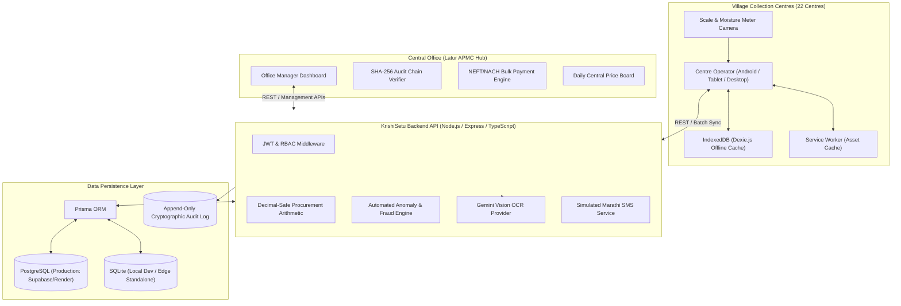

# KrishiSetu — Technical Design Document (TDD)

## 1. Executive Summary & Problem Context

**Client:** Farmer Producer Company (FPC), Latur, Maharashtra  
**Scale:** 6,200 member farmers across 140 villages, 22 village collection centres, 60 staff members, handling ~45,000 purchases and 15,000 tonnes of agricultural procurement annually (primarily Soybean and Tur).

### Core Pain Points Addressed:
1. **Paper-based procurement slips:** Handwritten slips prone to loss, damage, and mathematical errors.
2. **Manual Excel data entry:** Delaying payment reconciliations by weeks.
3. **Weight & moisture tampering:** Discrepancies between manual slips and actual electronic scale readings.
4. **Delayed bank payments:** Lack of consolidated bulk payment runs linked directly to verified bank accounts.
5. **Connectivity loss in village centres:** Frequent network outages stopping mandis from recording intake.

KrishiSetu is an enterprise SaaS platform that bridges remote village collection centres with the central office through an offline-first, cryptographic, role-based architecture.

---

## 2. Technology Stack & Key Libraries

| Tier | Technology | Rationale |
|---|---|---|
| **Frontend** | React 18, Vite, TypeScript | High-performance, low bundle size suitable for low-end mobile devices |
| **Styling** | Tailwind CSS, Lucide React, Recharts | Consistent agricultural design palette (`#527A50`, `#24452F`, `#F7F9F4`), no glassmorphism |
| **Offline Storage** | IndexedDB via Dexie.js | High-capacity browser storage for master data and offline purchase queues |
| **Service Worker** | Native Service Worker (`sw.js`) | Offline shell caching and PWA background capabilities |
| **Backend API** | Node.js, Express.js, TypeScript | Typed, lightweight REST services with transactional integrity |
| **Database & ORM** | PostgreSQL (Supabase/Render) / SQLite (Local Dev), Prisma ORM | Dual schema support allowing zero-config local runs and scalable cloud SQL |
| **Authentication** | JWT, bcryptjs | Stateless, role-based access control with fail-fast production secret validation |
| **AI Vision OCR** | Google Gemini Vision API (`gemini-3.5-flash-lite`) | Actual multimodal image analysis for electronic weighing scale & moisture meter displays |
| **Automated Testing** | Vitest, Supertest | Fast unit and end-to-end integration test execution (52 passing automated tests) |

---

## 3. High-Level System Architecture

---

## 4. Subsystem Detailed Designs

### 4.1. Gemini Vision API Integration & Discrepancy Gate

- **Module:** `server/src/lib/visionService.ts`
- **Supported Models:** Configurable via `GEMINI_MODEL` (default: `gemini-3.5-flash-lite`).
- **Prompt Architecture:** Specialized prompt instructing the model to extract gross weight (kg) or moisture (%), unit, confidence score (0.00–1.00), readability flag, and notes regarding glare/angle.
- **Fail-Safe & Rate Limit Resilience:**
  - 15-second `AbortController` timeout prevents request hanging during network latency.
  - HTTP 429 quota exhaustion is detected and surfaced clearly to the operator.
  - Logical bounds checking: Rejects scale values outside 0–50,000 kg and moisture outside 0–40%.
- **Non-Fabrication Guarantee:** When `GEMINI_API_KEY` is unconfigured, or when image clarity is below 0.50 confidence, the system never fabricates readings. It explicitly reports unreadable status and logs a supervisor manual override.
- **Independent Backend AI Mismatch Enforcement:**
  - Tolerances: Scale difference $\le 2.0\text{ kg}$; Moisture difference $\le 0.5\%$.
  - When manual entries differ from AI readings beyond tolerance, the backend strictly ignores client-supplied `aiVerificationStatus: 'MATCH'` bypass attempts.
  - Procurement creation is blocked with HTTP 403 unless an authenticated user with the `MANAGER` role approves the discrepancy with a mandatory non-empty review reason.
  - The manager's identity is strictly derived from the verified server-side JWT session (`req.user`), completely ignoring any client-supplied `managerId` to prevent identity spoofing by Centre Operators.
  - Stores `reviewerId`, `reviewDecision`, `reviewedBy`, `reviewedAt`, and `reviewNotes` in the purchase record.

### 4.2. Procurement Daily Price Board & Server Enforcement

- **Module:** `server/src/routes/purchase.routes.ts` & `server/src/routes/sync.routes.ts`
- **Security Rule:** **Never trust client-supplied rates.**
- **Backend Flow:**
  1. The server receives crop (e.g. Soybean) and grade (e.g. Grade A).
  2. Queries `PriceBoard` for the active published price (`isActive: true`).
  3. If no active price exists, the request is rejected with HTTP 400.
  4. The centrally published rate is assigned to `ratePerQuintal` and used in decimal-safe math. Client-supplied rate parameters are completely ignored.

### 4.3. Decimal-Safe Procurement Arithmetic

- **Module:** `server/src/lib/calculations.ts` & `client/src/lib/calculations.ts`
- **Formulas:**
  $$\text{Actual Weight} = \text{Gross Weight} - \text{Tare Weight}$$
  $$\text{Moisture Deduction \%} = \max(0, \text{Moisture} - 12) \times 1\%$$
  $$\text{Net Weight} = \text{Actual Weight} \times \left(1 - \frac{\text{Deduction \%}}{100}\right)$$
  $$\text{Total Amount} = \frac{\text{Net Weight} \times \text{Rate per Quintal}}{100}$$
- **Rounding Rules:** Weights are rounded to 1 decimal place (0.1 kg); monetary amounts are rounded to 2 decimal places (₹0.01).
- **Validation Gates:** Gross weight must exceed tare weight; negative values and zero weights are rejected.

### 4.4. Offline-First Synchronization & Conflict Handling

- **Module:** `client/src/services/syncManager.ts` & `server/src/routes/sync.routes.ts`
- **Storage:** Dexie IndexedDB maintains `offlineQueue`, `cachedFarmers`, and `cachedPrices`.
- **Idempotency:** Every client-generated purchase generates a UUID `idempotencyKey`. The server checks the key in `Purchase` and `SyncRecord` tables. If already processed, it returns `DUPLICATE_SKIPPED` with the existing slip number, guaranteeing zero duplicate entries.
- **Auto-Sync:** `SyncContext` monitors `window.addEventListener('online')` and triggers automatic queue draining when internet returns.
- **Non-Discard Guarantee:** Failed sync items are marked `status: 'FAILED'` with server error messages in IndexedDB, surviving browser refreshes and allowing operator review and retry.

### 4.5. Atomic Payment Run Safety

- **Module:** `server/src/routes/payment.routes.ts`
- **Concurrency Protection:** The entire eligibility re-check, `PaymentRun` creation, `Payment` item generation, and `Purchase` assignment run inside an isolated `prisma.$transaction`.
- **Eligibility Filter:** Only purchases with `status = 'APPROVED'`, `isFlagged = false`, `paymentRunId = null`, and `farmer.bankVerificationStatus = 'VERIFIED'` can be included.
- **Race Condition Prevention:** An atomic update condition (`where: { id: { in: ids }, paymentRunId: null }`) verifies that all purchases were claimed exclusively. If another manager creates a run concurrently, conflicting purchases throw an error and abort the transaction.
- **Status Separation:** Generating a payment run creates a batch with `status: 'PENDING'`. Only when bank processing callbacks succeed (`/simulate-bank`) does the status change to `'PAID'`.
- **Bank CSV Adapter:** Implements a generic mock bulk payment CSV adapter (`generateBankBulkPaymentCsv`) for NEFT/NACH integration.

### 4.6. Deep File Upload Binary Security

- **Module:** `server/src/middleware/upload.ts`
- **File Size Limit:** 5MB.
- **Sanitized Filenames:** Generated using `uuidv4()` + strictly sanitized extension, preventing path traversal attacks.
- **Binary Magic-Byte Inspection:** `isValidImageMagicBytes()` reads the first 12 bytes of uploaded files to verify genuine JPEG (`FF D8 FF`), PNG (`89 50 4E 47`), or WebP (`RIFF...WEBP`) signatures. Fake image files with spoofed extensions (e.g. PHP scripts named `.jpg`) are unlinked and rejected with HTTP 400.
- **Restricted Access:** The `/uploads` static directory is protected with `authenticateToken`, preventing public web scraping of farmers' scale and moisture photos.

### 4.7. Role-Based Access Control (RBAC) & Centre Boundaries

- **Roles:** `OPERATOR` and `MANAGER`.
- **Enforcement:**
  - `OPERATOR`: Restricted strictly to their assigned collection centre. Attempting to view slips, submit purchases, or record truck dispatches for another centre returns HTTP 403 Forbidden.
  - `MANAGER`: Full company-wide visibility across all 22 centres, daily price publishing, flagged purchase review, and payment run execution.

### 4.8. SHA-256 Chained Audit Ledger & Limitations

- **Module:** `server/src/services/auditService.ts` & `server/src/lib/crypto.ts`
- **Hash Chaining Formula:**
  $$\text{EventHash}_n = \text{SHA-256}\left(\text{EntityType} \mid \text{EntityId} \mid \text{Action} \mid \text{Actor} \mid \text{Timestamp} \mid \text{DetailsJSON} \mid \text{EventHash}_{n-1}\right)$$
- **Integrity Verifier:** `verifyAuditChainIntegrity()` traverses all audit records sequentially and recalculates hashes from the genesis block (`GENESIS_HASH_KRISHISETU_2026`).
- **Documented Security Limitations:**
  - Client-generated device timestamps and local browser storage (IndexedDB) cannot be assumed independently tamper-proof on a compromised, rooted, or clock-manipulated Android device.
  - Non-repudiation is achieved via server-side receipt timestamps (`serverReceivedTimestamp`), server formula recalculation, and the immutable server audit log chain.

---

## 5. Verification & Automated Test Results

The repository features 52 automated tests across 5 test suites (100% passing):

1. **`server/tests/security-fixes.test.ts` (22/22 passed):**
   - Production JWT secret validation (fail-fast on missing/insecure secret).
   - AI mismatch blocks operator procurement creation.
   - Authorized Office Manager approval allows AI variance creation.
   - Client-supplied procurement price is completely ignored.
   - Unpublished or invalid crop prices are rejected.
   - Operator centre access boundary enforcement (listing, creating, and retrieving slips).
   - Repeated offline sync does not duplicate purchases.
   - Flagged transactions cannot enter payment runs.
   - Concurrent payment run requests cannot duplicate transactions.
   - Deep image upload magic-byte inspection rejects fake images.
   - Cryptographic SHA-256 audit hash chain integrity verification.
2. **`server/tests/e2e-workflow.test.ts` (15/15 passed):**
   - Full end-to-end procurement and payment workflow.
3. **`server/tests/bankCsv.test.ts` (2/2 passed):**
   - Bank CSV formatting and RFC 4180 compliance.
4. **`server/tests/calculations.test.ts` (9/9 passed):**
   - Backend decimal-safe arithmetic engine.
5. **`client/tests/calculations.test.ts` (4/4 passed):**
   - Frontend math calculations matching backend formulas.

---

## 6. Known Limitations & Operational Assumptions

1. **Client-Side Hardware Time:** Local device timestamps on offline tablets are subject to device clock drift. The central server stamps `serverReceivedTimestamp` on all records as the official accounting receipt time.
2. **Commercial Bank Format:** A generic mock NEFT/NACH bulk payment CSV format is provided. Specific commercial banks (e.g. SBI CMP, HDFC Enet) require custom CSV column mapping adapters for production live bank integrations.
3. **Simulated SMS Gateway:** Simulated Marathi SMS delivery records message logs in the database. Production telecom deployment requires attaching an Indian DLT-approved SMS provider (e.g. Gupshup, ValueFirst, Airtel IQ).

